<div align="center">



<br>

<a href="https://portfoliofiqih.vercel.app"></a>
<a href="mailto:fiqihkurniadi2003@gmail.com"></a>

<br><br>


</div>


<div align="center"></div>

```text
+------------------------------------------------+
| fiqih27@lampung:~$ whoami                      |
+------------------------------------------------+
  Fiqih Kurniadi
  IT enthusiast dari Lampung

+------------------------------------------------+
| fiqih27@lampung:~$ cat education               |
+------------------------------------------------+
  SLTA  SMK N 1 CANDIPURO - 89
  S1    ILMU KOMPUTER
        UNIV. MUHAMMADIYAH METRO
        3.80 CUMLAUDE

+------------------------------------------------+
| fiqih27@lampung:~$ cat fokus                   |
+------------------------------------------------+
  web      website cepat, rapi,
           siap produksi
  server   deploy, konfigurasi,
           jaga layanan tetap hidup
  hardware rakit, upgrade, bongkar
           masalah sampai akarnya
```

> **Setiap baris code menuntun imajinasi menemukan bentuknya.**

<div align="center"></div>

<div align="center">

</div>

<div align="center"></div>

<div align="center">

<picture>
  <source media="(prefers-color-scheme: dark)" srcset="https://raw.githubusercontent.com/fiqih27/fiqih27/output/github-contribution-grid-snake-dark.svg">
  
</picture>

<br>


<br><br>



</div>
